<picture>
  <source media="(prefers-color-scheme: dark)" srcset="assets/ficha-dark.svg">
  <source media="(prefers-color-scheme: light)" srcset="assets/ficha-light.svg">
  
</picture>

**Convierto lo que hoy haces a mano en un sistema que trabaja por ti.**

Desarrollador full stack (diseño web, APIs, bases de datos y DevOps) y de apps móviles nativas en Android.

Colaboré con ECOSUR de mayo a agosto de 2026 en un sistema de automatización de procesos institucionales con .NET, MudBlazor y Entity Framework. Estudio el último año de Ingeniería en Tecnologías de la Información en la Universidad Politécnica de Chiapas y me gustaría especializarme en ciberseguridad o IA.

**Stack principal:** NestJS · Kotlin · Jetpack Compose · Java · .NET · PostgreSQL · MongoDB · Docker · AWS · RabbitMQ
